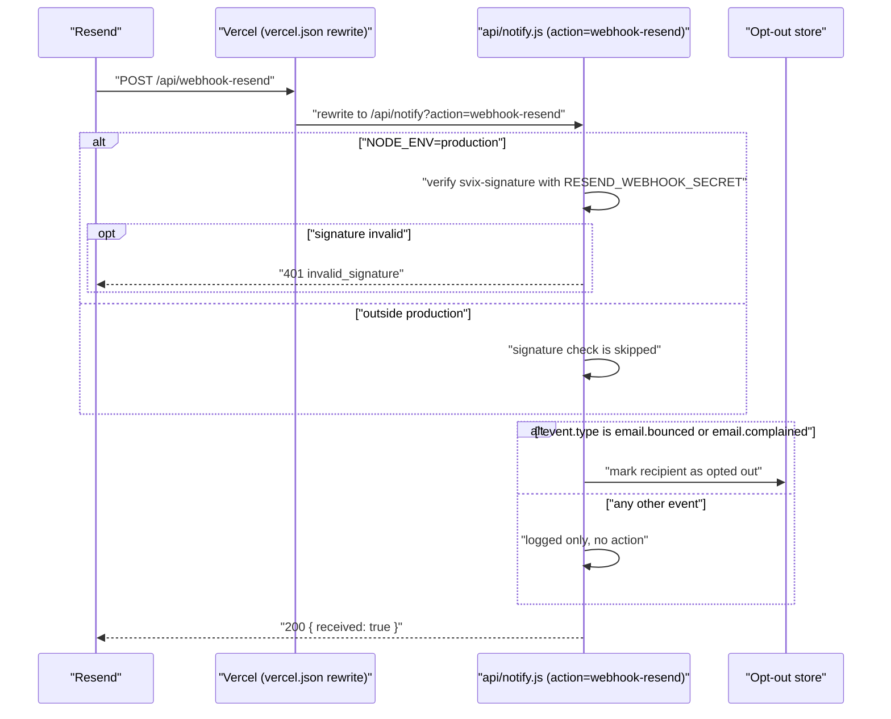

# Resend Email Service Setup - NikkeyBox

## Overview

NikkeyBox sends transactional email (order confirmations, account verification, password reset, cart recovery, payment review) through [Resend](https://resend.com), and receives delivery events back through a webhook. This guide documents the current code integration and how to finish wiring it up.

**Current state (2026-11-14)**: live in production. The Vercel project `nikkeysite` (team `nikkeybox`) has `RESEND_API_KEY`, `RESEND_WEBHOOK_SECRET`, `CRON_SECRET` and `UNSUBSCRIBE_SECRET` set for **Production** only, all as *sensitive*. A test from the Admin panel was delivered from `noreply@nikkeybox.jp`. Preview and Development have none of these, so email does not send from preview deploys.

Before that date, no Resend variable existed in Vercel and `/api/send-email` had no route in `vercel.json` (it returned 404), so the site had never sent an email.

All outgoing email goes through one helper, `sendMail()` in `api/_lib/mailer.js`. The sender is `NikkeyBox <noreply@nikkeybox.jp>` unless `RESEND_FROM_EMAIL` overrides it.

## Prerequisites

- ✅ Resend account created (https://resend.com)
- ✅ Domain verified in Resend dashboard
- ✅ NikkeyBox deployed on Vercel
- ✅ `resend` package installed (`npm install resend`)

## Environment Variables

| Variable | Used by | Status in Vercel | Notes |
|---|---|---|---|
| `RESEND_API_KEY` | `api/_lib/mailer.js` (`new Resend(...)`) | Production | Resend key `nikkeysite-production`: **sending access only**, restricted to the `nikkeybox.jp` domain. Without it, `sendMail()` throws `email_service_not_configured`. |
| `RESEND_WEBHOOK_SECRET` | `api/notify.js` (`verifyResendSignature`) | Production | Signing secret of the existing Resend webhook (see below). |
| `CRON_SECRET` | `api/cart-recovery.js` | Production | Authenticates the daily cart-recovery cron (`vercel.json` → `0 15 * * *`). Fallback key for `UNSUBSCRIBE_SECRET` and `CART_RECOVERY_SECRET`. |
| `UNSUBSCRIBE_SECRET` | `api/_lib/email-optout.js` | Production | Signs unsubscribe links. **Never rotate it**: every link already sent would stop working. |
| `SITE_ORIGIN` | `api/_lib/mailer.js` (`siteOrigin()`) | Not set, has a default | Defaults to `https://nikkeybox.jp`. Used to build the unsubscribe link. |
| `ORDER_NOTIFICATION_EMAIL` | `api/notify.js` (`type: 'store'`) | Not set, falls back | Falls back to `ADMIN_EMAIL`, which is set. |
| `RESEND_FROM_EMAIL` | `api/_lib/mailer.js` (`MAIL_FROM`) | Not set, has a default | Overrides the sender, e.g. `NikkeyBox <noreply@nikkeybox.jp>`. Must be on a verified domain. |

`.env.example` also lists `RESEND_FROM_NAME` and `RESEND_REPLY_TO`, but no code reads them. Reply-to and brand name are hardcoded constants (`MAIL_REPLY_TO`, `BRAND`) at the top of `api/_lib/mailer.js`; edit that file to change them.

Never prefix any of these with `VITE_`: Vite inlines `VITE_*` variables into the public browser bundle.

## Get a Resend API Key

### Via Vercel Marketplace (Recommended)
1. Go to https://vercel.com/marketplace/resend
2. Click "Add Integration"
3. Select your Vercel team and the NikkeyBox project
4. Authorize the integration
5. `RESEND_API_KEY` is added to your Vercel environment variables automatically

### Manual Setup
1. Log in to https://resend.com/api-keys
2. Click "Create API Key"
3. Name it (e.g. `nikkeybox-production`)
4. Copy the key (format: `re_xxxxxxxxxxxxx`) — do not share or commit it
5. Add it to the Vercel project: Project Settings → Environment Variables → `RESEND_API_KEY` (at least for Production)

## Configure Locally

Create `.env.local` in the project root:
```env
RESEND_API_KEY=re_your_api_key_here
```

## Webhook Setup

Resend posts delivery events to `/api/webhook-resend`. There is no standalone file for that route — `vercel.json` rewrites it to `/api/notify?action=webhook-resend`, handled by `handleWebhookResend` in `api/notify.js`.



### Current webhook

There is **one** webhook in Resend, already configured. Do not create a second one for the same URL.

- Endpoint: `https://nikkeybox.jp/api/webhook-resend`
- Events: `email.received`, `email.bounced`, `email.complained`
- Its signing secret is the value of `RESEND_WEBHOOK_SECRET` in Vercel

Only `email.bounced` and `email.complained` trigger an action (automatic opt-out). Every other event is accepted and logged.

### Rebuilding it from scratch
1. https://resend.com/webhooks → "Create Webhook" → endpoint `https://nikkeybox.jp/api/webhook-resend`
2. Select at least *Email bounced* and *Email complained*
3. Copy the **Signing Secret** (`whsec_...`) into `RESEND_WEBHOOK_SECRET` in Vercel (Production)
4. Redeploy: a new variable only takes effect on the next deploy

## How Signature Verification Works

`verifyResendSignature` (`api/notify.js`) reads the `svix-signature`, `svix-timestamp` and `svix-id` headers Resend sends (Resend delivers webhooks through Svix) and compares them against an HMAC computed with `RESEND_WEBHOOK_SECRET`.

Two details worth knowing:
- The check only runs when `NODE_ENV === 'production'`. Outside that (local dev, a preview deploy without that exact value), any payload is accepted.
- The HMAC is computed over `JSON.stringify(req.body)` — the body after Vercel's JSON parser — not the original request bytes.

## Sending Emails

`sendMail({ to, subject, html, unsubscribe })` (`api/_lib/mailer.js`) is the only way the project sends email. It is server-only — never import it from `src/` (the `@/` alias only resolves inside `src/`, and doing so would ship the Resend API key to the browser bundle).

```js
// from another file inside api/
import { sendMail, unsubscribeUrl } from './_lib/mailer.js';

await sendMail({
  to: 'customer@example.com',
  subject: 'Order confirmed',
  html: '<p>Your order has been confirmed.</p>',
  unsubscribe: unsubscribeUrl('customer@example.com'), // marketing email only
});
```

`sendMail` throws an error with a `code` and `statusCode` on failure: `email_service_not_configured` (503, missing `RESEND_API_KEY`), `email_validation_failed` (400), `email_send_failed` (503).

Real call sites: order confirmation (`api/stripe-webhook.js`, `api/orders.js`), payment-review notices (`api/_lib/fulfillment.js`), cart recovery (`api/cart-recovery.js`), account emails — verify/reset (`api/notify.js`), and custom-order notifications to the store (`api/public-forms.js`).

### From the browser: `/api/send-email`

The frontend (`src/services/emailService.ts`, `src/services/mailService.ts`) never sends content. It posts a `type` to `/api/send-email`, which `vercel.json` rewrites to `/api/notify?action=email`, and the server renders the template.

| `type` | Auth | Recipient |
|---|---|---|
| `verify`, `welcome` | Logged-in user | The user's own email |
| `verify-admin` | Admin | Body `to` (resend a verification link) |
| `password-reset` | None (rate-limited by IP and email) | Body `to`; same response whether the account exists or not |
| `order` | Order owner | Email on the order |
| `tracking`, `store` | Admin | Customer / `ORDER_NOTIFICATION_EMAIL` or `ADMIN_EMAIL` |
| `test` | Admin | **Always** the logged-in admin's email; the body cannot set a recipient |

## Testing in production

Admin panel → **"Testar notificações"**. It sends `type: 'test'` and delivers "Teste de envio – NikkeyBox" to the logged-in admin through the same `sendMail()` used by real emails, so it proves key, domain and sender at once. Confirm in the Resend dashboard (Emails) that it shows as *delivered*.

## Troubleshooting

### "API Key not found" / emails not sending
1. Verify `RESEND_API_KEY` is set (`.env.local` locally, Vercel env variable in production)
2. After adding or changing a Vercel variable, **redeploy**: running deployments keep the old values
3. Restart the dev server after changing `.env.local`
4. Check the Resend dashboard logs for the actual error
5. If the browser gets a 404 on `/api/send-email`, the rewrite is missing from `vercel.json`

### Rotating the API key
Create a new sending-only key restricted to `nikkeybox.jp`, replace `RESEND_API_KEY` in Vercel, redeploy, send a test from the Admin panel, then delete the old key in Resend. Do **not** rotate `UNSUBSCRIBE_SECRET`.

### "invalid_signature" from the webhook
1. Confirm `RESEND_WEBHOOK_SECRET` in Vercel matches the signing secret shown in the Resend webhook settings
2. Remember the check is skipped outside `NODE_ENV=production` — a 401 only happens in production

### Webhook not receiving events
1. Confirm the endpoint URL in Resend matches the deployment exactly (`https://<domain>/api/webhook-resend`)
2. Check Vercel function logs for `[resend webhook]` entries
3. Resend can resend a specific past event from its dashboard for debugging

## Files

| File | Role |
|---|---|
| `api/_lib/mailer.js` | `sendMail()`, hardcoded sender (`MAIL_FROM`/`MAIL_REPLY_TO`/`BRAND`), `siteOrigin()`, `unsubscribeUrl()` |
| `api/notify.js` (`handleEmail`) | `/api/send-email` handler: one branch per `type` (table above) |
| `api/notify.js` (`handleWebhookResend`) | Webhook handler: signature check, bounce/complaint opt-out |
| `api/_lib/email-optout.js` | Opt-out store and unsubscribe-link signing (`UNSUBSCRIBE_SECRET`) |
| `vercel.json` | Rewrites `/api/send-email` → `/api/notify?action=email` and `/api/webhook-resend` → `/api/notify?action=webhook-resend`; cart-recovery cron |
| `.env.example` | Template for environment variables (includes a few that are unused — see above) |

## References

- Resend docs: https://resend.com/docs
- Resend webhooks: https://resend.com/docs/webhooks
- Vercel integration: https://vercel.com/marketplace/resend
